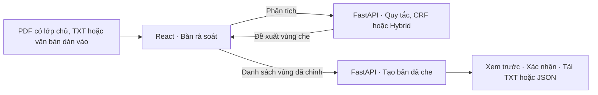

# MedShield

**Nhận diện và che thông tin định danh trong văn bản y tế**

## Nguyễn Tiến Đạt

**Chủ dự án · Samsung Innovation Campus (SIC) · Lớp AI-NIC4 · Đề tài số 2**

MedShield giúp chuẩn bị bản chia sẻ từ ghi chú y tế. Ứng dụng đề xuất các đoạn chứa định danh và hiển thị bản gốc cạnh bản đã che để người dùng kiểm từng vùng. Sau khi sửa và xác nhận danh sách vùng che, người dùng có thể tải bản kết quả dưới dạng TXT hoặc JSON.

[Chạy trên Windows](#chạy-nhanh-trên-windows) · [Demo 3 phút](#demo-3-phút) · [Kết quả thực nghiệm](#kết-quả-thực-nghiệm) · [Kiến trúc](#kiến-trúc) · [Bộ tài liệu nộp bài](docs/ban-giao-nop-bai.md)


## Từ ghi chú đến bản đã che

| Bước | Thao tác trên web |
| --- | --- |
| **Nhập** | Dán văn bản, tải TXT UTF-8, trích chữ từ PDF hoặc bấm **Dùng ví dụ giả lập**. |
| **Phân tích** | Chọn ngôn ngữ và phương pháp. MedShield đánh dấu các vùng có thể chứa tên, ngày sinh, số điện thoại, mã định danh hoặc địa chỉ. |
| **Rà soát** | Định vị từng vùng trong văn bản gốc, đổi nhãn, bỏ vùng che nhầm hoặc bôi chọn đoạn còn sót để thêm vùng che. |
| **Xuất** | Kiểm bản xem trước, tích xác nhận rà soát rồi tải TXT hoặc JSON. Khi sửa văn bản gốc, kết quả phân tích và xác nhận cũ hết hiệu lực. |

Ví dụ sau khi duyệt ba vùng che trên một ghi chú giả lập:

```text
Người bệnh [NAME_1], sinh ngày [DOB_1], mã [ID_1]. Hẹn khám lại 18/12.
```

Các ký hiệu thay thế cho biết loại định danh đã che. Trong cùng một tài liệu, cùng giá trị nguyên văn và cùng nhãn sẽ dùng lại cùng ký hiệu. Ngày tái khám `18/12` vẫn đọc được vì nằm ngoài ba vùng đã duyệt. [Hướng dẫn gán nhãn](docs/annotation-guide.md)

## Chạy nhanh trên Windows

Cài Git, `uv`, Node.js 24 và npm. Nếu đã có thư mục MedShield, mở PowerShell tại thư mục đó. Nếu lấy mã nguồn lần đầu, chạy hai lệnh sau.

```powershell
git clone https://github.com/TdatVn-fpt/MedShield.git
Set-Location MedShield
```

**Cửa sổ 1 · API**

Từ thư mục gốc MedShield, đồng bộ môi trường Python 3.11.7 theo lockfile rồi chạy FastAPI.

```powershell
uv sync --locked --python 3.11.7
uv run --locked uvicorn apps.api.main:app --host 127.0.0.1 --port 8000 --no-access-log
```

**Cửa sổ 2 · Web**

Mở PowerShell thứ hai tại thư mục gốc MedShield, rồi chạy Vite.

```powershell
Set-Location apps/web
npm ci
npm run dev
```

Giữ hai cửa sổ mở. Vào web và chờ dòng **API đã kết nối**. [Mở MedShield](http://127.0.0.1:5173/) · [Kiểm tra API](http://127.0.0.1:8000/health)

## Demo 3 phút

Để chạy thử nhanh, chọn **Dùng ví dụ giả lập** → **Tiếng Việt** → **Kết hợp · hybrid** → **Phân tích**. Để trình diễn đầy đủ, dùng PDF mẫu có hai trang. [Tải PDF bệnh án ngoại trú giả lập](docs/evidence/demo-benh-an-ngoai-tru.pdf)

1. Bấm **Nhập PDF**, chọn tệp mẫu, đặt **Trang đầu** là `1`, **Trang cuối** là `2` rồi bấm **Trích văn bản**.
2. Đối chiếu phần chữ trong **Văn bản gốc**, chọn **Kết hợp · hybrid** và bấm **Phân tích**.
3. Tìm đoạn `tạ hư cấu`. Nếu tên chưa được che, bôi chọn tên, đặt nhãn `NAME` rồi bấm **Thêm vùng che**.
4. Kiểm **Bản đã che** và giữ nguyên ngày tái khám `18/12`. Tích **Tôi đã rà soát toàn bộ nội dung**, chọn **Tải TXT**, rồi mở tệp tải về để đối chiếu.

Có thể dùng bản TXT của cùng ca để thực hành luồng rà soát khi trình diễn. [Mẫu TXT](docs/evidence/demo-benh-an-ngoai-tru.txt) · [Kịch bản demo chi tiết](docs/huong-dan-nhap-pdf.md)

## Phương pháp nhận diện

MedShield dùng năm nhãn `NAME` (tên người), `DOB` (ngày sinh), `PHONE` (điện thoại), `ID` (mã định danh) và `ADDR` (địa chỉ).

| Phương pháp | Ngôn ngữ | Cách tạo đề xuất |
| --- | --- | --- |
| **Quy tắc · baseline** | Việt, Anh | Dùng mẫu có ngữ cảnh như từ dẫn, kiểu ngày và cấu trúc số để đề xuất các vùng thuộc năm nhãn. |
| **NER · mô hình học** | Việt | Mô hình CRF học chuỗi nhãn từ ghi chú giả lập và đề xuất tên người, địa chỉ. |
| **Kết hợp · hybrid** | Việt | Gộp đề xuất từ quy tắc và CRF, xử lý vùng giao nhau và sắp theo thứ tự xuất hiện trong ghi chú. |

Mỗi phát hiện giữ thông tin về nguồn đề xuất. Danh sách rà soát ưu tiên các số điện thoại cần người dùng kiểm tra thêm. [Chi tiết từng chế độ và cách xử lý chồng lấn](docs/engines.md)

## Kết quả thực nghiệm

Bảng dưới đây ghi kết quả **Phase Q2** trên cùng **20 ghi chú tiếng Việt giả lập với 33 vùng đã gán nhãn**. Dự đoán được tính đúng khi khớp cả nhãn, vị trí bắt đầu và vị trí kết thúc. Phép chấm dùng đầu ra tự động trước khi người dùng sửa.

| Cấu hình | TP / FP / FN | Micro-F1 | Ghi chú có ít nhất một vùng bị sót |
| --- | ---: | ---: | ---: |
| Quy tắc | 20 / 1 / 13 | 74,07% | 8/20 |
| NER · CRF | 12 / 0 / 21 | 53,33% | 12/20 |
| Kết hợp · hybrid | 25 / 1 / 8 | **84,75%** | **5/20** |

CRF được huấn luyện trên 60 ghi chú giả lập và chọn cấu hình bằng 20 ghi chú validation. Khoảng tin cậy 95% của micro-F1 cho Hybrid trên tập lịch sử là **70,18%–94,92%**. Tập 150 ghi chú giả lập dùng để kiểm tra hồi quy. Việc đánh giá trên tập độc lập thuộc Phase E đang chờ hoàn tất gán nhãn, phân xử và khóa tập. [Báo cáo Phase Q2](docs/phase-q2.md) · [Quy trình Phase E](docs/phase-e.md) · [Kết quả tổng hợp mà web đọc](artifacts/evaluation.json)

Presidio, Philter UCSF và GEMINI pyDeid được chạy riêng trên 16 ghi chú tiếng Anh giả lập. Bài đối chứng đó đo vùng che theo vị trí ký tự. [Báo cáo thực nghiệm](docs/experiment.md) · [Lệnh tái tạo đối chứng](docs/upstream.md)

## Kiến trúc



PDF.js đọc lớp chữ của PDF trên trình duyệt. Khi bấm **Phân tích**, web gửi văn bản đã trích tới FastAPI cục bộ. API biểu diễn mỗi vùng bằng khoảng Unicode code point `[start, end)`. Web chuyển vị trí chọn UTF-16 của trình duyệt sang đơn vị đó để giữ đúng biên khi gặp emoji hoặc dấu tổ hợp. [Sơ đồ chi tiết](docs/architecture.md) · [Hợp đồng API](docs/api-contract.md)

| Endpoint | Nhiệm vụ |
| --- | --- |
| `GET /health` | Kiểm tra API và trạng thái từng cặp ngôn ngữ, phương pháp. |
| `POST /api/analyze` | Phân tích văn bản và trả các vùng đề xuất. |
| `POST /api/redact` | Tạo bản che từ danh sách vùng đang được người dùng rà soát. |
| `GET /api/evaluation` | Đọc kết quả đã lưu để hiển thị trên trang **Thực nghiệm**. |

### Đọc mã nguồn theo mục đích

| Muốn tìm | Mở trước |
| --- | --- |
| Giao diện, nhập PDF và trạng thái rà soát | [`apps/web/`](apps/web/) · [`App.tsx`](apps/web/src/App.tsx) · [`useReview.ts`](apps/web/src/useReview.ts) |
| Điều phối API, chọn phương pháp và tạo bản che | [`apps/api/`](apps/api/) · [`controllers.py`](apps/api/controllers.py) · [`analysis.py`](apps/api/services/analysis.py) · [`redaction.py`](apps/api/services/redaction.py) |
| Huấn luyện CRF và chấm kết quả | [`ml/`](ml/) · [`train.py`](ml/train.py) · [`scoring.py`](ml/scoring.py) · [`evaluate.py`](ml/evaluate.py) |
| Dữ liệu giả lập và trọng số CRF | [`data/`](data/) · [Manifest test](data/test-manifest.json) · [Metadata mô hình](artifacts/model/metadata.json) |
| Kiểm thử Python và Chromium | [`tests/`](tests/) · [`apps/web/e2e/`](apps/web/e2e/) |
| Công cụ tái tạo và đặc tả | [`scripts/`](scripts/) · [`specs/`](specs/) · [`AGENTS.md`](AGENTS.md) · [Constitution](.specify/memory/constitution.md) |

## Kiểm thử và tái tạo

Chạy các lệnh Python từ thư mục gốc. Lệnh đánh giá ghi kết quả tiếng Việt vào thư mục cục bộ được Git bỏ qua.

```powershell
uv run --locked pytest -q
uv run --locked python scripts/check_source.py
uv run --locked python -m ml.evaluate --output-dir artifacts/local/nop-bai
```

Chạy các lệnh frontend từ `apps/web`. Cần cài Chromium của Playwright ở lần chạy kiểm thử đầu tiên.

```powershell
npm run lint
npm run typecheck
npm run format:check
npx playwright install chromium
npm run test:e2e
npm run build
```

Bộ kiểm thử trình duyệt bao phủ luồng gọi API, nhập PDF, sửa vùng che, tải tệp sau xác nhận, đổi văn bản để vô hiệu kết quả cũ và hiển thị ở 390 px, 1440 px. [Biên bản kiểm thử PDF](docs/reviews/G4-pdf.md) · [Môi trường Windows](docs/environment.md)

### Lỗi thường gặp

| Dấu hiệu | Cách kiểm tra |
| --- | --- |
| npm báo `ENOENT` | Mở PowerShell tại `apps/web` rồi chạy lại. |
| Cổng 8000 hoặc 5173 đã được dùng | Mở đường dẫn API và web ở phần chạy nhanh để kiểm tra tiến trình MedShield đang chạy. |
| NER hoặc Hybrid hiện chưa khả dụng | Chọn **Tiếng Việt** và kiểm tra `metadata.json` cùng trọng số trong `artifacts/model/`. |
| PDF thiếu lớp chữ ở một số trang | Chọn dải trang có văn bản hoặc tải TXT UTF-8. |

## Dữ liệu và quyền riêng tư

- Dùng ghi chú giả lập khi demo. API xử lý văn bản nhập và ánh xạ ký hiệu trong bộ nhớ. Trước khi tải, người dùng rà soát cả vùng còn sót và vùng che nhầm.
- PDF cần có lớp chữ, tối đa 10 MiB mỗi tệp và 10 trang mỗi lần trích. Văn bản phân tích tối đa 50.000 Unicode code point. Định dạng xuất hiện có là TXT và JSON.
- Khi cần cấu hình riêng, dùng tệp `.env.local` cho các giá trị lưu trên máy và nạp chúng vào môi trường trước khi chạy. Git bỏ qua tệp này và `artifacts/local/`. [Mẫu biến môi trường](.env.example) · [Quy tắc bỏ qua của Git](.gitignore)

## Tài liệu và nguồn tái sử dụng

- **Nộp bài và bảo vệ** · [Bộ tài liệu nộp bài](docs/ban-giao-nop-bai.md) · [Câu hỏi bảo vệ](docs/defense-qa.md)
- **Thiết kế và tiến độ** · [Đặc tả sản phẩm](docs/spec.md) · [Bảng tiến độ](docs/progress.md)
- **Đóng góp, phiên bản và giấy phép** · [Đóng góp và hỗ trợ AI](docs/contributions.md) · [Nguồn và giấy phép bên thứ ba](THIRD_PARTY.md)
