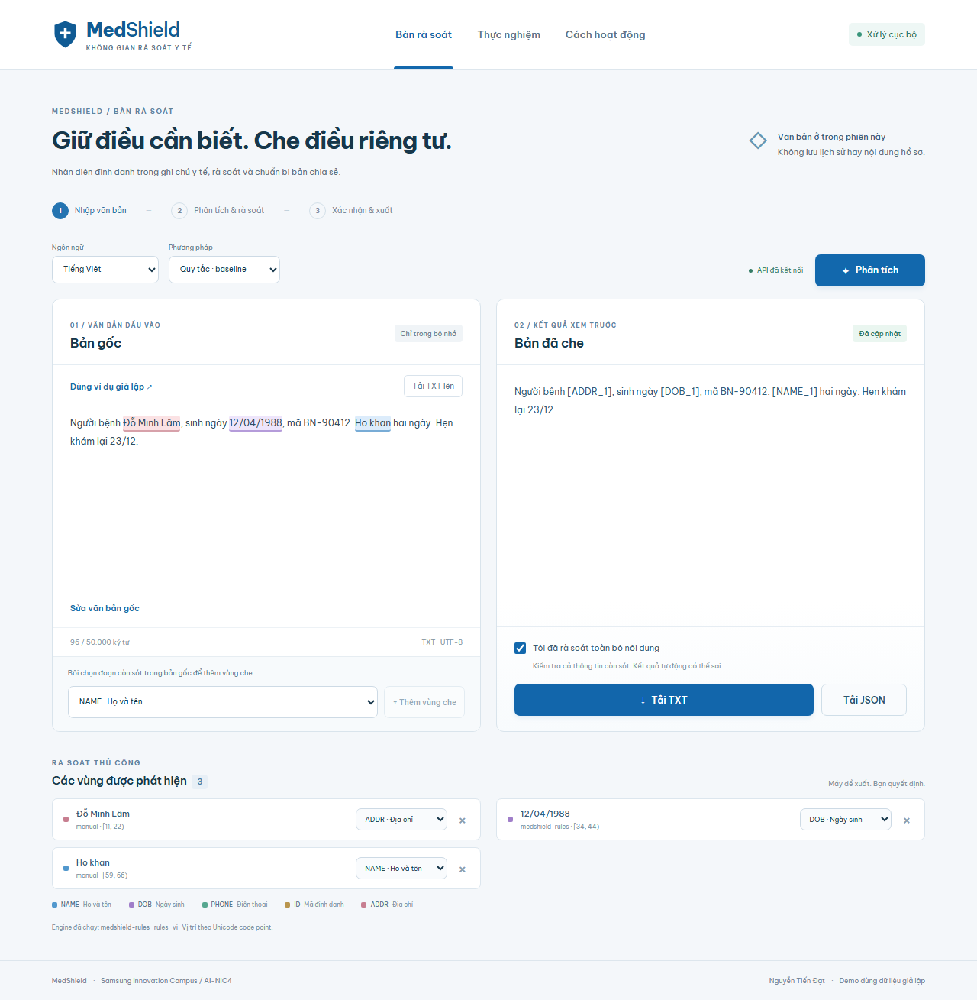

# MedShield

**Nhận diện và che thông tin định danh trong văn bản y tế**

## Nguyễn Tiến Đạt

**Chủ dự án · Samsung Innovation Campus (SIC) · Lớp AI-NIC4 · Đề tài số 2**

MedShield hỗ trợ chuẩn bị bản chia sẻ từ ghi chú y tế. Hệ thống đề xuất năm nhóm thông tin cần che gồm tên người, ngày sinh, số điện thoại, mã định danh và địa chỉ. Người dùng xem bản gốc cạnh bản đã che, điều chỉnh vùng cần che và xác nhận trước khi xuất TXT hoặc JSON.

## Cách MedShield xử lý văn bản

Giao diện React và TypeScript tiếp nhận văn bản dán, TXT và PDF có lớp chữ. PDF.js trích chữ ngay trong trình duyệt. FastAPI phân tích phần văn bản trên máy cục bộ và trả các vùng đề xuất để người dùng rà soát.

MedShield kết hợp hai cách nhận diện. Bộ quy tắc dựa vào ngữ cảnh và cấu trúc của giá trị. Mô hình CRF học từ ghi chú tiếng Việt giả lập để nhận diện tên người và địa chỉ. Chế độ Hybrid gộp các đề xuất và xử lý vùng chồng lấn trước khi hiển thị. [Kiến trúc hệ thống](docs/architecture.md) · [Các phương pháp nhận diện](docs/engines.md)

## Kết quả thực nghiệm

Trên tập lịch sử gồm 20 ghi chú tiếng Việt giả lập và 33 vùng đã gán nhãn, Hybrid đạt **micro-F1 84,75%** trước khi người dùng sửa. Một dự đoán được tính đúng khi khớp cả nhãn và hai biên của vùng. Hybrid tìm đúng 25 vùng, đề xuất thừa 1 vùng và bỏ sót 8 vùng. Có 5/20 ghi chú vẫn còn phần định danh chưa được che. [Kết quả Q2 và phân tích lỗi](docs/phase-q2.md)

## Tài liệu dự án

- [Tổng quan đề tài](docs/ban-giao-nop-bai.md)
- [Đặc tả và phạm vi](docs/spec.md)
- [Báo cáo thực nghiệm](docs/experiment.md)
- [Đóng góp và nguồn tái sử dụng](docs/contributions.md) · [Giấy phép bên thứ ba](THIRD_PARTY.md)
