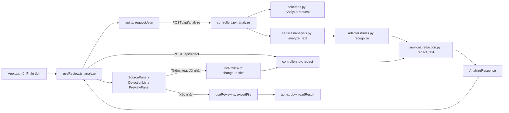

# Từ nút Phân tích đến bản đã che

Sơ đồ phản ánh luồng G1. Khi bổ sung NER/hybrid ở G2, service chọn adapter theo mode và vẫn trả cùng Entity; tài liệu sẽ cập nhật theo code tích hợp.

## Liên hệ ASP.NET MVC

| Kiến thức ASP.NET | Trong MedShield | Vai trò |
|---|---|---|
| Controller/action và routing | `controllers.py`, FastAPI decorators | Nhận HTTP, chuyển dữ liệu đã kiểm tra cho service |
| ViewModel/model validation | `schemas.py`, Pydantic | Nhãn, kiểu, giới hạn, trường dư; không chứa xử lý giao diện |
| Service layer | `services/analysis.py`, `services/redaction.py` | Chọn engine, kiểm span, tạo token nhất quán |
| Adapter/dependency | `adapters/` | Chuyển kết quả engine thành Entity chuẩn |
| View | React components | Hiển thị bản gốc, bản che và thao tác rà soát |
| Trạng thái màn hình | `useReview.ts` | Revision request, preview, xác nhận; chỉ trong bộ nhớ |

Không cần model database trong phạm vi này. Mô hình dữ liệu Entity khác với mô hình học máy CRF: Entity là hợp đồng vị trí/nhãn, CRF là bộ trọng số học từ ví dụ.

## Vì sao giữ văn bản gốc

API dùng code point `[start,end)`, Python slice trực tiếp. Browser dùng UTF-16 cho selection nên `unicode.ts` chuyển vị trí; highlight dùng các code point của nguyên bản. Không NFC/NFD-normalize sau nhận diện. `redact_text` ghép các đoạn từ trái sang phải dựa trên vị trí gốc, tránh việc thay một tên làm lệch vị trí những tên sau. Token map chỉ tồn tại trong lời gọi hàm; cùng `(nhãn, slice chính xác)` dùng lại token, mỗi tài liệu đếm lại.

## Tránh kết quả cũ và lộ dữ liệu

`useReview` tăng revision khi input/entity/config thay đổi. Response chỉ được áp dụng khi revision trùng. Thay đổi hủy preview/xác nhận ngay; chỉ tải bản che hiện hành sau xác nhận. Server không giữ session/input. Validation và exception được chuyển thành thông báo chung, không trả `input` của Pydantic hoặc log exception có thể chứa ghi chú. Response có `Cache-Control: no-store`.
